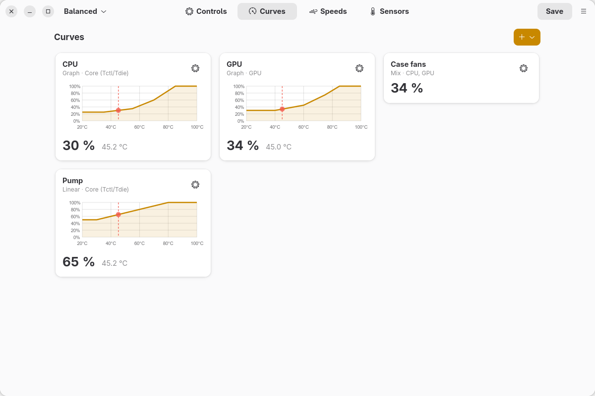
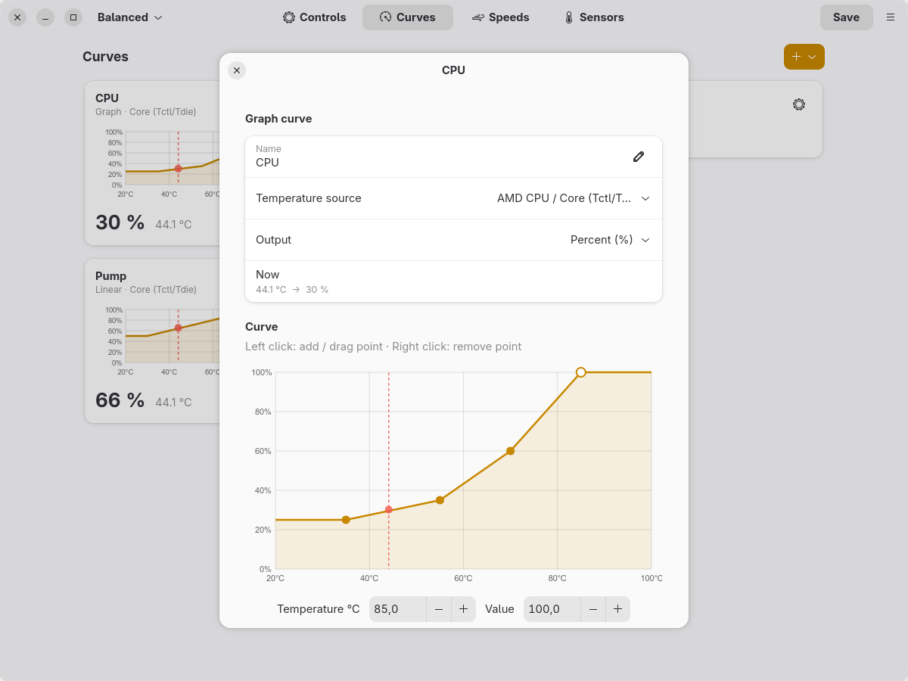
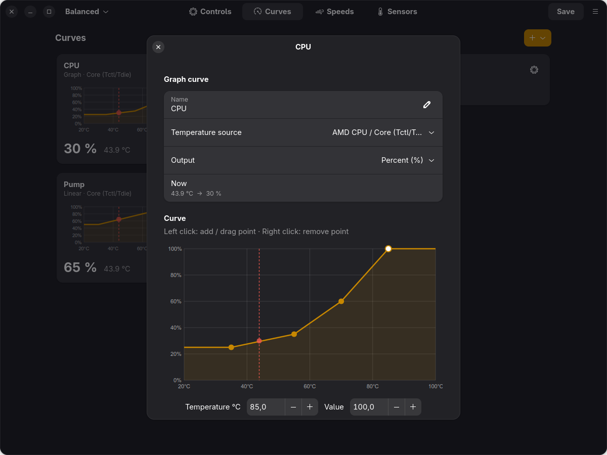
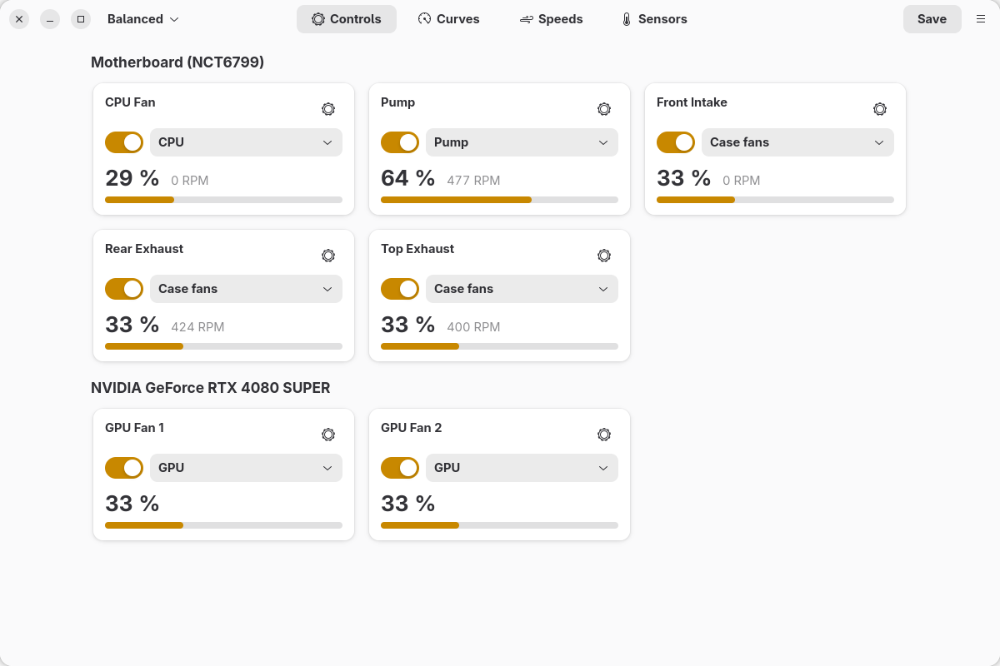
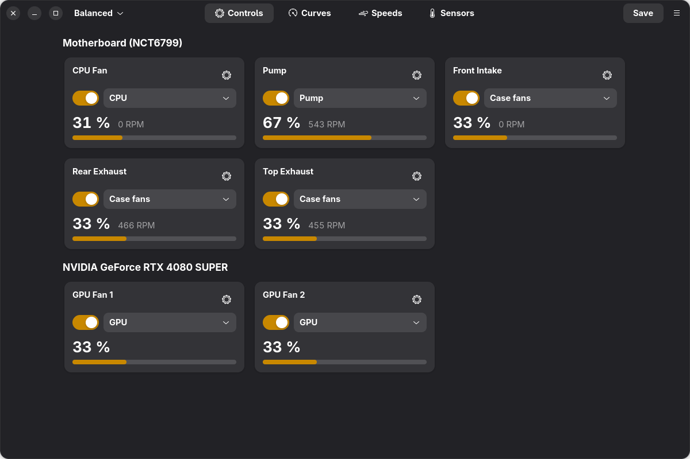
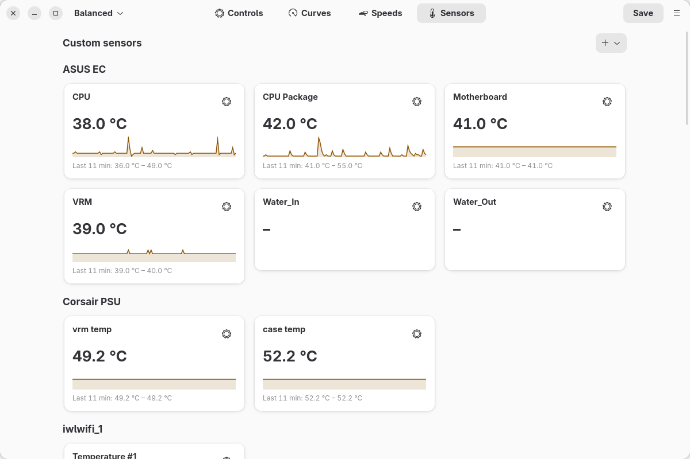
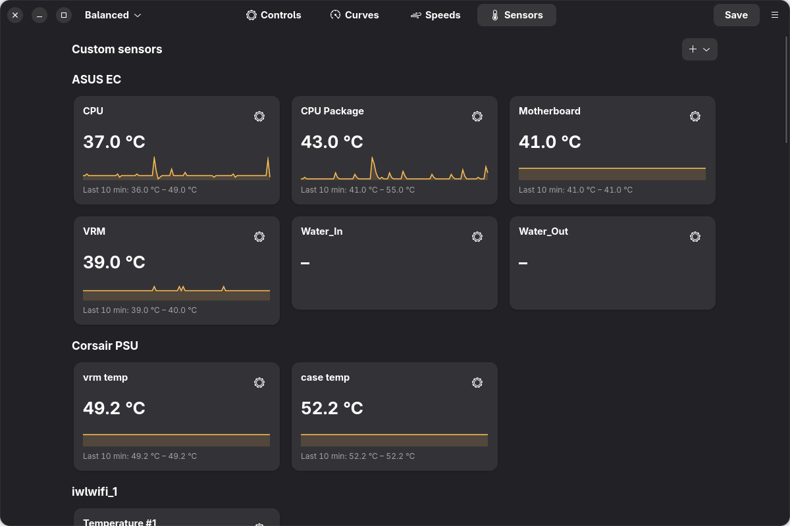
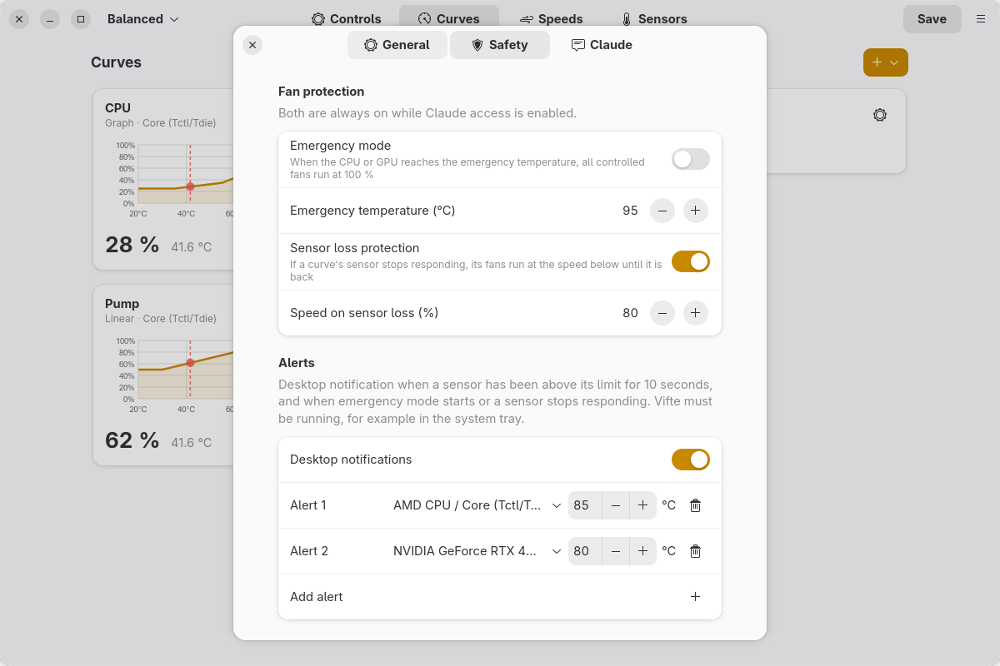
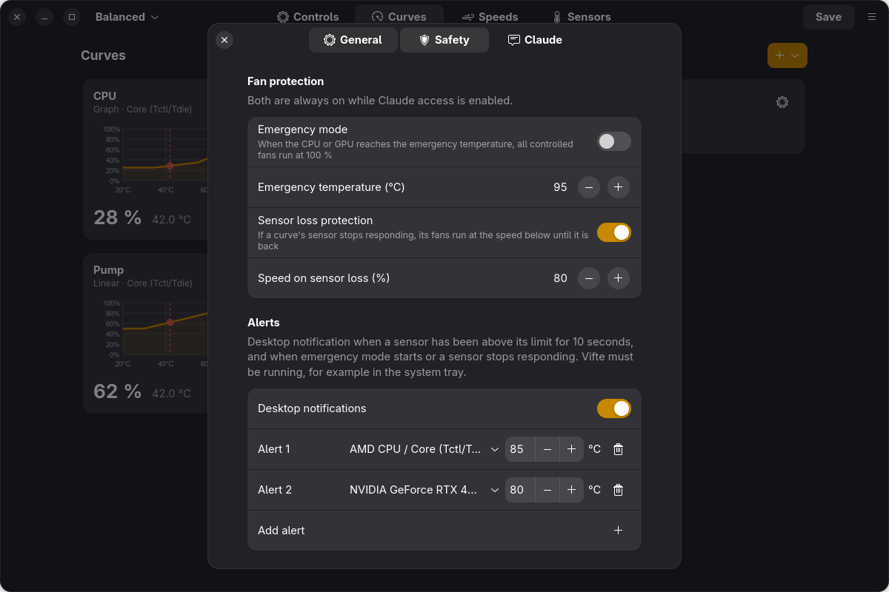

# Vifte – FanControl for Linux

[](https://github.com/Vindihaaret/vifte/actions/workflows/ci.yml)

<p align="center">
  <picture>
    <source media="(prefers-color-scheme: dark)" srcset="docs/screenshots/curves-dark.png">
    
  </picture>
</p>

Vifte is a native Linux fan control application modelled on [FanControl](https://getfancontrol.com) by
Rem0o. It has the same features and **reads and writes the same configuration files** (`userConfig.json`
etc.), so configurations can be moved between Windows and Linux.

* **Native GTK 4 / libadwaita interface** that fits into GNOME and follows the light/dark theme.
* **Background service (`vifted`)** that controls the fans from boot, with or without the window open,
  and hands the fans back to the BIOS when it stops.
* **System tray icon** with a menu and optional temperature readouts, like FanControl.
* **Claude integration (MCP)**: let Claude read your sensors and tune curves and fans for you – within
  hard safety limits enforced by Vifte.
* **Emergency mode**: above a set CPU/GPU temperature every controlled fan runs at 100 %.
* **Sensor loss protection**: if a curve's sensor stops responding, its fans run at a safe speed instead
  of staying where they were.
* **Optional temperature alerts** as desktop notifications, and a **30-minute history graph** on every
  sensor card.
* English, Norwegian, German, French and Spanish user interface.
* No Wine, no .NET.

*From Norway with Love ❤️*

> Vifte is an independent project and is not affiliated with FanControl or its author.

Made by **Jan Ivar Sørensen** using [Claude Code](https://claude.com/claude-code), Anthropic's AI coding
assistant – from working out the FanControl configuration format to the GTK interface, the background
service, the tray icon, the safety features and the Claude integration.

## Screenshots

| Light | Dark |
|---|---|
|  |  |
|  |  |
|  |  |
|  |  |

## Requirements

* Linux with systemd
* Python ≥ 3.10 with PyGObject and pycairo
* GTK ≥ 4.12 and libadwaita ≥ 1.5 (e.g. Fedora 40+, Ubuntu 24.04+, openSUSE Tumbleweed, Arch)
* A kernel driver that exposes PWM fan control in `/sys/class/hwmon` (see [Supported hardware](#supported-hardware))
* Optional: NVIDIA driver (NVML) for NVIDIA GPU fans
* Optional, GNOME only: the *AppIndicator and KStatusNotifierItem Support* extension for the tray icon

## Installation

```bash
git clone https://github.com/Vindihaaret/vifte.git
cd vifte
./install.sh          # asks for your sudo password
```

The script:

* installs missing dependencies (zypper, dnf, apt or pacman),
* copies the program to `/opt/vifte` and adds the `vifte` command,
* installs and starts `vifted.service`,
* creates the `vifte` group and adds you to it (this gives the GUI access to the service),
* tries the common Super I/O drivers (`nct6775`, `nct6683`, `it87`) and, if one of them provides fan
  control, loads it at every boot,
* adds a menu entry and starts the tray icon at login.

Start **Vifte** from the application menu, or run `vifte`.

### Uninstall

Open **Settings → General** in the app and click **Uninstall** at the bottom, or run `vifte uninstall` (or `sudo vifte-uninstall`).
The service is stopped and the fans are handed back to the BIOS. The configurations in `/var/lib/vifte`
are kept unless you tick the box in the dialog (or pass `--purge`).

## Supported hardware

Vifte uses the standard Linux hwmon interface, so anything with a hwmon driver works:

| Hardware | Linux driver | Identifier |
|---|---|---|
| Motherboard (Nuvoton) | `nct6775`, `nct6683` | `/lpc/nct6798d/control/N`, `/fan/N`, `/temperature/N` |
| Motherboard (ITE) | `it87` | `/lpc/it8686e/...` |
| AMD CPU | `k10temp`, `zenpower` | `/amdcpu/0/temperature/2` (Tctl), `/3…` (CCD), `/9` (CCDs max), `/10` (average) |
| Intel CPU | `coretemp` | `/intelcpu/0/temperature/N` |
| NVIDIA GPU | NVML | `NVApiWrapper/0-<chip>-A/sensor/0`, `/control/N`, `/fan/N` |
| AMD GPU | `amdgpu` | `/gpu-amd/0/...` |
| NVMe / SATA | `nvme` / `drivetemp` | `/nvme/N/...`, `/hdd/N/...` |
| Anything else | hwmon | `/hwmon/<name>/<index>/...` (Linux only) |

Identifiers follow the names LibreHardwareMonitor uses on Windows wherever possible, which is what makes
FanControl configurations portable. Fan numbering (control/fan) matches Windows. Temperature numbering on
the motherboard chip can differ between the Linux driver and LibreHardwareMonitor; use **Map …** if needed.

## Claude integration (MCP)

Vifte includes an [MCP](https://modelcontextprotocol.io) server, so Claude can work with your fans
directly: read temperatures and fan speeds, pair and calibrate fans, build and tune curves, watch how the
system behaves over time, and save the result when you are happy.

### Turn it on

1. In Vifte: **Settings → Claude → Allow control from Claude**. No restart is needed. Before access is
   turned on, Vifte reminds you that Claude is an AI and can make mistakes – keep an eye on temperatures
   and check the result yourself – and, if no pump is marked, recommends marking your AIO or custom-loop
   pump first (**Mark the pump first** takes you there).
2. Connect it to Claude Code – click **Add** in the same section, or run:

   ```bash
   claude mcp add --scope user vifte -- vifte mcp
   ```

   For Claude Desktop, add this to `claude_desktop_config.json`:

   ```json
   { "mcpServers": { "vifte": { "command": "vifte", "args": ["mcp"] } } }
   ```

3. Start a new Claude session and ask, for example:
   * *"Look at my fans and temperatures and suggest quieter curves."*
   * *"Make the case fans follow whichever is hotter, CPU or GPU."*
   * *"Pair and calibrate my fans, then set up a balanced profile and save it as Quiet."*

Turning the switch off blocks every call immediately. While it is on, the app shows a notification for
every change Claude makes.

### Safety

The rules are enforced by the Vifte service itself – not by Claude or the MCP process – so they apply
however Claude connects:

* **Fans never stop.** Nothing Claude configures can take a fan below the *lowest fan speed* (default
  25 %, set by you in the app). Stop % can't be set above the lowest possible output, and calibration done
  by Claude never goes below the limit either.
* **Curves must follow temperature.** Claude may only use graph, linear, auto and mix (max/average)
  curves. Curves must never fall as temperature rises, and must reach 100 % at or below the *emergency
  temperature*. Hysteresis and response times are capped so fans react quickly to heat.
* **Emergency mode is always on** while Claude has access: if a CPU or GPU core temperature reaches the
  emergency temperature (default 95 °C), every controlled fan runs at 100 % until it has cooled 7 °C.
* **Pumps and locked fans are off limits.** Claude can read them, but can't change, calibrate or pair a
  control marked as a pump or locked by you – nor the curves and sensors it uses.
* **Sensor loss protection is always on** while Claude has access, and never below the lowest fan speed:
  if a curve's sensor stops responding, its fans run at the chosen speed until it is back.
* **Limited reach.** Claude can't delete or import configurations, overwrite an existing configuration,
  pause fan control, change the update interval or the safety limits, or uninstall anything. Handing a
  fan back to the BIOS is always allowed.
* **Easy to undo.** Changes take effect immediately but are not saved until Claude (with your OK) saves
  them; every save keeps a timestamped backup in `/var/lib/vifte/Configurations/backups/`. Claude can undo
  its own changes as long as you haven't changed the configuration in the app since.

### Tools

| Tool | What it does |
|---|---|
| `get_status` | Safety limits, all fans (output, RPM, curve, settings), temperatures, curves, custom sensors |
| `get_history` | Temperatures and fan outputs for the last 30 minutes (5 s samples) |
| `get_curve` | Full definition of a curve and whether it meets the safety rules |
| `create_curve` / `update_curve` / `delete_curve` | Manage graph, linear, auto and mix curves |
| `configure_control` | Assign a curve, set a fixed speed, offset, minimum, start/stop, steps, or hand back to BIOS |
| `create_custom_sensor` | Max/average of several sensors, or a short time average |
| `rename_sensor` | Friendlier names for sensors |
| `pair_fans` / `calibrate_control` / `get_task` | Find which fan belongs to which output; measure RPM |
| `list_configurations` / `switch_configuration` / `save_configuration` | Profiles |
| `undo` | Revert the last change |

## Using a configuration from Windows

1. Copy the file from `FanControl\Configurations\` on Windows (e.g. `userConfig.json`).
2. In Vifte: **Menu → Import FanControl configuration …** (or `vifte -c userConfig.json`).
3. If some sensors don't exist on Linux under the same identifier, a banner appears. Click **Map …** and
   choose which Linux sensor each entry should use. The mapping is stored *outside* the file, so the
   file still works in FanControl on Windows.
4. **Menu → Export configuration …** gives you a file to take back to Windows.

Vifte keeps every field it doesn't know about, and writes the file in the same format it was read
(the `FanControl`/`MainWindow` layout from v260+, or the older `Main` layout).

## Features

**Controls:** enable/disable, curve selection, manual control, offset, minimum %, start %, stop %,
step up/down, force apply, pairing with a speed sensor (manual or automatic), calibration (RPM table and
start/stop), hide/show, rename.

**Curves:** Graph (drag points; left click adds, right click removes), Linear, Flat, Mix
(max/min/average/sum/subtract), Trigger, Sync, Auto. Hysteresis up/down, response time up/down, ignore
hysteresis at min/max, one-way hysteresis (older files), RPM mode (requires calibration).

**Custom sensors:** Mix, time average, file (`.sensor`, first line = °C), offset.

**Arrange cards and groups:** on the **Sensors** and **Speeds** pages, drag a card and drop it on another
card in the same group to move it. To move a whole group (for example the graphics card), drag it by its
heading (⠿) and drop it on another group; the other groups move along. Dragging down places it after the
group you drop on, dragging up places it before. Cards never move between groups. The page scrolls by
itself when you drag near the top or bottom. The order is stored in the configuration (the order of the
sensor lists, as in FanControl) when you save.

**Names:** a speed sensor you haven't named is shown with the name of the fan it is paired with (for
example *AIO Pump* instead of *Fan #7*). This is display only – the configuration file keeps its own names,
as on Windows – and can be turned off under **Settings → General → Speeds use the fan's name**.

**Other:** multiple configurations (profiles) with quick switching, Fahrenheit (**Settings → General**), show hidden cards, hide
fan speed cards, update interval, pause (BIOS takes over).

**System tray:** a tray icon with a menu (show window, switch configuration, pause, quit) that can also
show sensor values as numbers, like FanControl. Click the gear on a sensor card → **Show in system tray**.
The choice is stored in `TrayIcons` in the configuration, with the same colours as on Windows. While the
tray icon is active, closing the window keeps Vifte in the tray. The icon starts at login (can be turned
off under **Settings → General**). GNOME needs the *AppIndicator and KStatusNotifierItem Support*
extension; KDE and most other desktops support it out of the box.

**Emergency mode:** turn it on under **Settings → Safety**. When a CPU or GPU core temperature reaches
the emergency temperature (default 95 °C), all controlled fans run at 100 % until it has cooled 7 °C, and
a red banner shows which sensor triggered it.

**Sensor loss protection:** if the sensor behind a curve stops responding for 5 seconds (for example if
the NVIDIA driver fails or a hwmon driver is unloaded), the fans using that curve run at a fixed speed
(default 80 %) instead of staying at their last value, and a red banner names the sensor. Normal control
resumes as soon as the sensor is back. A mix sensor counts as lost if any of its sensors is missing, since
the missing one could be the hottest. Fans whose sensor never worked are left to the BIOS. On by default;
the switch and the speed are under **Settings → Safety**.

**AIO and other pumps:** Linux often exposes more fan headers than FanControl on Windows can control –
including the pump header of an AIO or custom loop. Mark the pump so nothing else can touch it: click the
gear on its card → **Pump and Claude → Type**:
* **Pump – automatic** – the pump or BIOS controls it (recommended, and right for pumps that regulate themselves):
  Vifte never writes to the header, even if a configuration enables it.
* **Pump – fixed speed**, for pumps that follow the PWM signal: a fixed speed of at least 70 %, and 100 %
  in emergency mode.

A pump is never driven by curves, never calibrated, never turned down by automatic pairing, and Claude
can't change it. The marking belongs to the machine (stored in `/var/lib/vifte/state.json`), so it
applies whichever configuration is active. Under the same gear you can also lock any fan so Claude can't
change it (**Claude can't change this**).

**Alerts:** optional desktop notifications, turned on under **Settings → Safety → Alerts**. Add one or more
sensors with a limit below the emergency temperature; you get a notification when a sensor has stayed
above its limit for 10 seconds, and not again until it has dropped 3 °C below it. With alerts on, you
also get a notification when emergency mode starts or a sensor stops responding. Vifte must be running
(for example in the system tray) for notifications to appear.

**History graphs:** every sensor card shows a small graph of the last 30 minutes, with the lowest and
highest value. Useful when tuning curves by hand.

**Suspend and resume:** after the PC wakes from sleep or hibernation, Vifte takes the fans back by
itself. Some hwmon drivers reset `pwm_enable` on resume, which silently hands the fans to the BIOS; Vifte
checks the mode before every write and sets manual mode again if it was lost, and `vifte-resume.service`
also restarts the service after resume.

**Load testing with Stress (optional):** [Stress](https://github.com/Vindihaaret/stress) is a separate,
free program that puts the CPU and graphics card under controlled load while you watch the temperatures –
useful when tuning fan curves. **Menu → Open Stress** starts it; if it isn't installed, the same entry says
**Download Stress …** and links to it. Vifte works just as well without it. With both connected to Claude,
Claude can run a steady load, adjust the curves in Vifte and run the same load again to compare.

**Quit:** **Menu → Quit** (Ctrl+Q) closes the window and the tray icon. The service keeps controlling the
fans. To hand the fans back to the BIOS, use **Menu → Pause control**.

**Updates:** **Menu → Check for updates …** looks for a new release on GitHub. If there is one, you see
what's new and can update with one click (you confirm with your password; the app restarts itself).
Vifte also checks automatically once a month and shows a notification – this can be turned off under
**Settings → General**. Only the public GitHub API is contacted; nothing about you or your system is sent.

**Theme:** follows the system light/dark setting, or choose Light/Dark under **Settings → General → Theme**. The
choice is stored in the same fields FanControl uses (`SyncThemeWithWindows`/`SelectedTheme`).

**Language:** English, Norwegian, German, French and Spanish. The default follows the system language;
change it under **Settings → General → Språk / Language**, or set `VIFTE_LANG` (`en`, `nb`, `de`, `fr`, `es`) for
the command line. Translations live in `vifte/locales/` (keyed by the English text) – contributions for
more languages are welcome.

### Command line

```
vifte                      open the window
vifte -c gaming.json       switch to (or import and switch to) a configuration
vifte status               show the active configuration, fan speeds and temperatures
vifte list | save | pause | resume
vifte -r                   rescan hardware
vifte tray                 tray icon only (like "Start minimized")
vifte mcp                  MCP server for Claude (started by Claude Code / Claude Desktop)
vifte uninstall [--purge]  uninstall (--purge also deletes the configurations)
```

## Differences from the Windows version

* **Colours:** the accent colour follows the desktop. `PrimaryColor`/`SecondaryColor` are kept in the file.
* **Plugins** for FanControl (.NET) can't be loaded. File sensors cover many of the same needs.
* **NVIDIA:** as on Windows, 0 % hands control back to the card (zero-RPM mode); otherwise the minimum
  is 30 %.
* The field names for **Sync curves** and **offset sensors** are not documented by FanControl; Vifte reads
  the common variants and keeps the rest. The **Auto curve** algorithm is an approximation of FanControl's.

## Troubleshooting

* `journalctl -u vifted -f` shows the service log.
* No motherboard fans? Check `cat /sys/class/hwmon/hwmon*/name` for an `nct…` or `it…` chip.
  * Many boards need `acpi_enforce_resources=lax` on the kernel command line before `nct6775`/`it87` can
    load.
  * Newer ITE chips (e.g. on Gigabyte boards) need the out-of-tree driver from
    [frankcrawford/it87](https://github.com/frankcrawford/it87).
  * Then run `sudo modprobe <driver>` and **Menu → Rescan hardware**.
* "Permission denied" from the GUI: the service only accepts root and members of the `vifte` group. Run
  `./install.sh` again to add your user.
* Tray icon not showing on GNOME: enable the *AppIndicator and KStatusNotifierItem Support* extension and
  run `vifte tray`.

## Files

| Path | Contents |
|---|---|
| `/var/lib/vifte/Configurations/*.json` | the configurations (FanControl format) |
| `/var/lib/vifte/state.json` | active configuration, update interval, sensor mappings, safety settings, pumps and Claude locks |
| `/var/lib/vifte/sensors/` | default folder for file sensors |
| `/run/vifte/vifte.sock` | socket between the GUI and the service |
| `/var/lib/vifte/Configurations/backups/` | backups made before Claude saves |
| `~/.config/vifte/settings.json` | per-user settings (language, tray, alerts, update checks) |

## Development

Run the tests (simulated hardware – no fans are touched):

```bash
python3 -m unittest discover -s tests -v
```

Run the app against a test service that never writes to the hardware:

```bash
python3 -m vifte.daemon --user-test          # terminal 1
VIFTE_SOCKET=$XDG_RUNTIME_DIR/vifte.sock python3 -m vifte.cli gui   # terminal 2
```

## License

Copyright © 2026 Jan Ivar Sørensen

Vifte is free software: you can redistribute it and/or modify it under the terms of the
[GNU General Public License](LICENSE) as published by the Free Software Foundation, either version 3 of
the License, or (at your option) any later version.

Vifte is distributed in the hope that it will be useful, but WITHOUT ANY WARRANTY; without even the
implied warranty of MERCHANTABILITY or FITNESS FOR A PARTICULAR PURPOSE. Controlling fans can affect the
cooling of your hardware – keep an eye on your temperatures.
